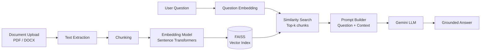
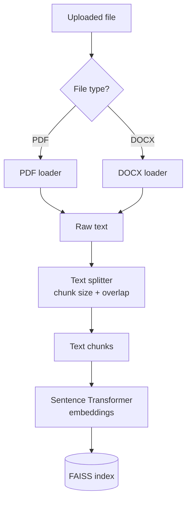
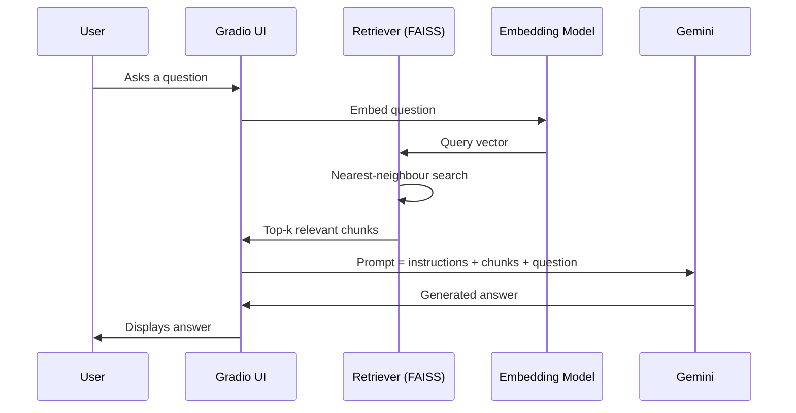
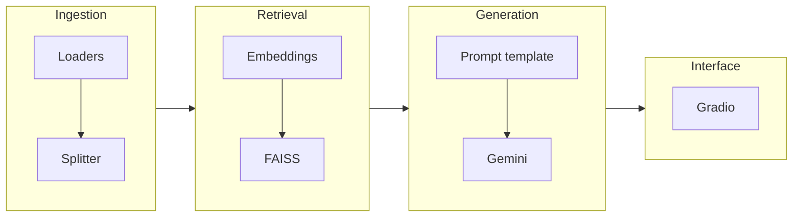

<div align="center">

# 📄 Document Q&A System

### Retrieval-Augmented Generation (RAG) Pipeline with LangChain, FAISS and Gemini

*Upload a PDF or DOCX, ask questions in plain English, and get answers grounded in your document.*


</div>

---

## 📑 Table of Contents

1. [Overview](#-overview)
2. [Problem Statement](#-problem-statement)
3. [Solution](#-solution)
4. [Features](#-features)
5. [System Architecture](#-system-architecture)
6. [Theory and Concepts](#-theory-and-concepts)
7. [Pipeline Walkthrough](#-pipeline-walkthrough)
8. [Tech Stack](#-tech-stack)
9. [Repository Structure](#-repository-structure)
10. [Getting Started](#-getting-started)
11. [Usage](#-usage)
12. [Configuration and Tuning](#-configuration-and-tuning)
13. [Limitations](#-limitations)
14. [Future Work](#-future-work)
15. [Contributing](#-contributing)
16. [Author](#-author)

---

## 🔎 Overview

**Document Q&A System** is a question answering application built on the **Retrieval-Augmented Generation (RAG)** pattern. A user uploads a document (PDF or DOCX), the system indexes its content in a **FAISS** vector database, and a **Gemini** language model answers questions using only the most relevant passages retrieved from that document.

The whole pipeline is orchestrated with **LangChain** and exposed through a simple **Gradio** web interface.

---

## ❗ Problem Statement

Reading long documents to find a specific answer is slow, and general-purpose LLMs have two well-known weaknesses when asked about private documents:

- **No access to your data:** an LLM has never seen your contract, report or research paper.
- **Hallucination:** when an LLM lacks the facts, it may produce confident but incorrect answers.
- **Context window limits:** a long document may not fit into a single prompt.

The goal: *let users ask natural-language questions about a document and get answers that are grounded in its actual content.*

---

## 💡 Solution

RAG solves these problems by splitting the task into two stages:

1. **Retrieve:** find the few passages in the document most relevant to the question.
2. **Generate:** give those passages to the LLM as context and ask it to answer from them.

This keeps the prompt small, anchors the answer in the source text, and avoids retraining or fine-tuning any model.

---

## ✨ Features

- 📂 **PDF and DOCX support** for document ingestion
- ✂️ **Chunking** of long documents into retrievable segments
- 🧠 **Sentence Transformer embeddings** for semantic search
- ⚡ **FAISS vector database** for fast similarity search
- 🤖 **Gemini-powered answer generation** grounded in retrieved context
- 🖥️ **Gradio interface** for upload and chat-style querying
- 🔗 **LangChain orchestration** tying the stages together

---

## 🏗️ System Architecture

### 1. High-Level Workflow



### 2. Indexing Phase (Offline, once per document)



### 3. Query Phase (Online, per question)



### 4. Component Responsibilities



---

## 📚 Theory and Concepts

### 1. What Is RAG?

**Retrieval-Augmented Generation** combines an **information retrieval** system with a **generative language model**. Instead of relying only on what the model memorised during training (*parametric memory*), RAG supplies relevant external text at query time (*non-parametric memory*).

```
Answer = LLM( question + retrieved context )
```

| Approach | Pros | Cons |
|---|---|---|
| **Plain LLM** | Simple | No private knowledge, can hallucinate |
| **Fine-tuning** | Bakes knowledge into the model | Expensive, goes stale, hard to update |
| **RAG** *(this project)* | Up-to-date, cheap, traceable to sources | Quality depends on retrieval |

### 2. Chunking

LLMs and embedding models have input limits, and a single embedding for a whole document would blur its meaning. Documents are therefore split into smaller **chunks**.

- **Chunk size:** too small loses context, too large dilutes meaning.
- **Chunk overlap:** a small overlap between neighbouring chunks prevents a sentence or idea from being cut in half at a boundary.
- **Recursive splitting:** splits on paragraphs, then sentences, then words, keeping text semantically coherent where possible.

### 3. Embeddings

An **embedding** maps text to a dense numeric vector so that **semantically similar texts are close together** in vector space.

- This project uses **Sentence Transformer** models, which are trained to produce good sentence-level embeddings.
- The same model must embed both the document chunks and the user question so they live in the same space.
- Because meaning rather than keywords is compared, a question like *"How much did revenue grow?"* can match a chunk that says *"sales increased by 12%"*.

### 4. Vector Databases and FAISS

**FAISS** (Facebook AI Similarity Search) is a library for efficient similarity search over large collections of vectors.

- Stores chunk embeddings in an **index**.
- Given a query vector, returns the **k nearest neighbours**.
- Common similarity measures: **cosine similarity**, **inner product**, or **L2 (Euclidean) distance**.
- Runs locally and needs no external service, which suits prototypes and small to medium document sets.

### 5. Retrieval (Top-k Similarity Search)

```
score(q, c) = similarity( embed(q), embed(c) )
retrieved   = top-k chunks by score
```

`k` controls the trade-off: a low `k` may miss needed facts, while a high `k` adds noise and raises cost and latency.

### 6. Prompt Construction and Grounded Generation

The retrieved chunks are inserted into a prompt template, typically along these lines:

```text
Answer the question using only the context below.
If the answer is not in the context, say you don't know.

Context:
{retrieved_chunks}

Question: {question}
```

Instructing the model to rely on the provided context is what makes the answer **grounded** and reduces hallucination.

### 7. Why Gemini?

**Gemini** is Google's family of large language models, accessed through an API. It handles the **generation** step: reading the retrieved context and producing a fluent, natural-language answer. Because retrieval is separate from generation, the LLM can be swapped for another provider without changing the rest of the pipeline.

### 8. Role of LangChain

**LangChain** is an orchestration framework that provides ready-made components for document loaders, text splitters, vector store wrappers, prompt templates and chains. It reduces glue code and keeps each stage modular and replaceable.

---

## 🔁 Pipeline Walkthrough

| Step | Stage | What happens |
|:---:|---|---|
| 1 | **Upload** | User provides a PDF or DOCX file through the Gradio UI |
| 2 | **Extract** | Text is read from the file using the matching loader |
| 3 | **Chunk** | Text is split into overlapping chunks |
| 4 | **Embed** | Each chunk is converted to a vector with a Sentence Transformer |
| 5 | **Index** | Vectors are stored in a FAISS index |
| 6 | **Ask** | User types a question |
| 7 | **Retrieve** | The question is embedded and the top-k closest chunks are fetched |
| 8 | **Generate** | Gemini receives the chunks plus the question and writes the answer |
| 9 | **Respond** | The answer is shown in the interface |

---

## 🧰 Tech Stack

| Layer | Tools |
|---|---|
| Language | Python |
| Orchestration | LangChain |
| Embeddings | Sentence Transformers |
| Vector store | FAISS |
| LLM | Google Gemini API |
| Interface | Gradio |
| Environment | Jupyter Notebook |

---

## 📁 Repository Structure

```text
Document-QA-RAG-Pipeline-System/
├── Document-QA-Rag-pipeline-system.ipynb   # Complete RAG pipeline and Gradio app
└── README.md
```

---

## 🚀 Getting Started

### Prerequisites

- Python 3.9+
- A **Google Gemini API key** ([get one from Google AI Studio](https://aistudio.google.com/))
- Jupyter Notebook, JupyterLab, or Google Colab

### Installation

```bash
# 1. Clone the repository
git clone https://github.com/vishal-mundewadi/Document-QA-RAG-Pipeline-System.git
cd Document-QA-RAG-Pipeline-System

# 2. (Optional) create a virtual environment
python -m venv venv
source venv/bin/activate        # Windows: venv\Scripts\activate

# 3. Install dependencies
pip install langchain langchain-community faiss-cpu sentence-transformers \
            google-generativeai gradio pypdf python-docx jupyter
```

> Package names can vary with LangChain versions. If an import fails, check the install cell at the top of the notebook for the exact packages used.

### API Key Setup

Set your key as an environment variable rather than hard-coding it:

```bash
export GOOGLE_API_KEY="your-api-key-here"      # Windows: set GOOGLE_API_KEY=your-api-key-here
```

> 🔒 Never commit API keys to GitHub.

---

## ▶️ Usage

1. Open the notebook:
   ```bash
   jupyter notebook Document-QA-Rag-pipeline-system.ipynb
   ```
2. Run all cells to build the pipeline.
3. Launch the **Gradio** interface from the final cell.
4. Upload a **PDF** or **DOCX** file.
5. Type a question and read the answer.

### Example

| | |
|---|---|
| **Question** | *What is this document about?* |
| **Behaviour** | Relevant chunks are retrieved and Gemini summarises the document's subject from them |

---

## ⚙️ Configuration and Tuning

| Parameter | Effect | Guidance |
|---|---|---|
| **Chunk size** | Amount of text per chunk | Smaller for precise facts, larger for broader context |
| **Chunk overlap** | Shared text between neighbours | Roughly 10 to 20% of chunk size is a common starting point |
| **Top-k** | Chunks sent to the LLM | Start around 3 to 5 and adjust |
| **Embedding model** | Retrieval quality and speed | Larger models are usually more accurate but slower |
| **Temperature** | Randomness of the LLM | Keep low for factual Q&A |

---

## ⚠️ Limitations

- **Retrieval quality limits answer quality:** if the right chunk is not retrieved, the answer will be incomplete or wrong.
- **Scanned PDFs:** image-only PDFs need OCR, which is not included.
- **Tables and figures:** complex layouts may extract poorly as plain text.
- **Single-document focus:** the index is built per upload session.
- **No persistent storage:** the FAISS index lives in memory unless saved to disk.
- **No source citations yet:** answers are not linked back to page numbers.

---

## 🔮 Future Work

- [ ] Show **source chunks and page numbers** alongside each answer
- [ ] **Multi-document** indexing and querying
- [ ] **Persist** the FAISS index to disk for reuse
- [ ] **Conversation memory** for follow-up questions
- [ ] **Hybrid search** combining keyword (BM25) and vector retrieval
- [ ] **Re-ranking** of retrieved chunks
- [ ] **OCR** support for scanned documents
- [ ] Retrieval and answer **evaluation** (e.g. RAGAS)
- [ ] **Docker** packaging and cloud deployment

---

## 🤝 Contributing

Contributions, issues and feature requests are welcome.

1. Fork the repository
2. Create a feature branch: `git checkout -b feature/your-feature`
3. Commit your changes: `git commit -m "Add your feature"`
4. Push: `git push origin feature/your-feature`
5. Open a Pull Request

---

## 👤 Author

**Vishal Mundewadi**
GitHub: [@vishal-mundewadi](https://github.com/vishal-mundewadi)

---

<div align="center">

⭐ If you found this project useful, consider giving it a star!

</div>
